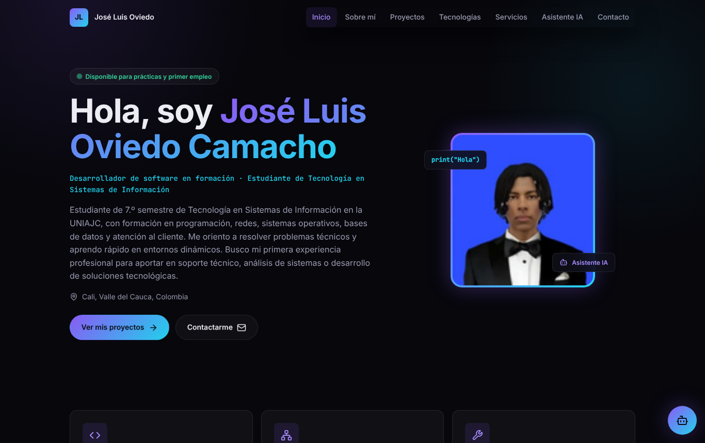
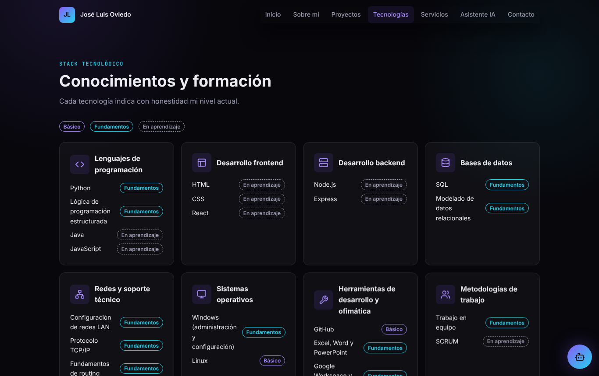
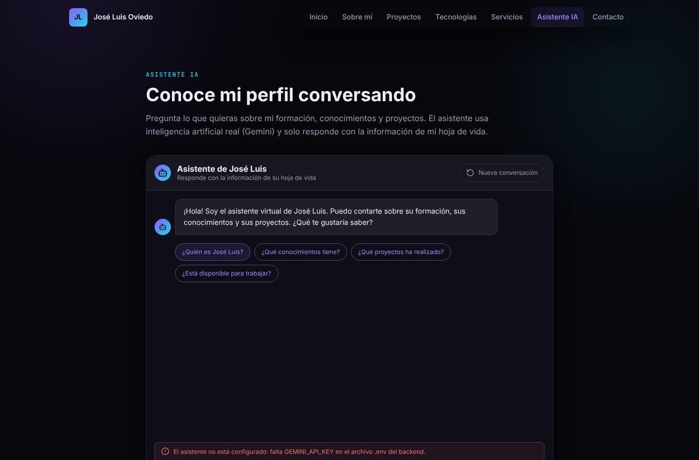
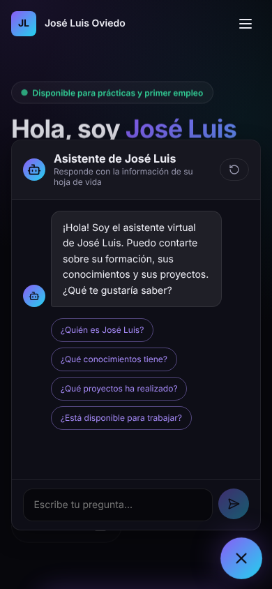
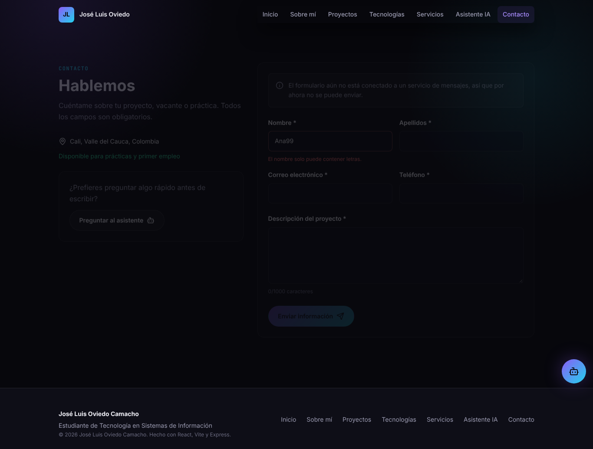

# Portafolio IA — José Luis Oviedo Camacho

Portafolio profesional con **asistente de inteligencia artificial** integrado. Construido con **React + Vite** en el frontend y **Node.js + Express** en el backend, que se conecta a la API de **Google Gemini**.



---

## 1. Descripción general

Aplicación web que presenta el perfil de José Luis Oviedo Camacho, estudiante de 7.º semestre de Tecnología en Sistemas de Información (UNIAJC): su biografía, proyectos, conocimientos, formación, trayectoria y servicios. Incluye un chatbot que conversa con los visitantes y responde **solo con la información real de su hoja de vida**.

## 2. Objetivos

- Presentar el perfil profesional de forma moderna, honesta y fácil de navegar.
- Mostrar proyectos con filtros, paginación y un panel de detalles.
- Ofrecer un asistente IA real (no respuestas predefinidas) como elemento diferenciador.
- Demostrar en la práctica los conceptos de JavaScript y React del curso.
- Proteger las credenciales: la API Key nunca llega al navegador.

## 3. Tecnologías utilizadas

| Capa | Tecnologías |
| --- | --- |
| Frontend | React 18, Vite 5, JavaScript ES6+, HTML5, CSS3, React Router DOM 6, Lucide React |
| Estado | useState, useEffect, useContext, useMemo, useRef, useCallback, hooks propios (`useChat`, `useLocalStorage`) |
| Backend | Node.js 20+, Express 4, dotenv, cors |
| IA | Google Gemini mediante `@google/genai` |
| Almacenamiento | LocalStorage (historial del chat) y datos en objetos/arreglos de JavaScript |
| Pruebas | Vitest + Testing Library (frontend), `node:test` (backend) |

## 4. Arquitectura

```
Navegador (React)  ──POST /api/chat──▶  Express (backend)  ──API Key──▶  Gemini
       ▲                                     │
       └──────────── { reply } ◀─────────────┘
```

- El frontend **nunca** conoce la API Key: solo llama a `/api/chat`.
- En desarrollo, Vite reenvía `/api` a `http://localhost:3001` (proxy en `vite.config.js`), así no hay problemas de CORS.
- El backend valida el mensaje, limita las solicitudes, recorta el historial y añade el prompt del sistema con el perfil real.

```
Portafolio-personal/
├── frontend/
│   ├── public/                 # foto de perfil y favicon
│   ├── src/
│   │   ├── components/
│   │   │   ├── layout/         # Navbar, Footer
│   │   │   ├── ui/             # Button, SectionTitle, SocialLinks, Carousel, DynamicIcon
│   │   │   ├── projects/       # ProjectCard, ProjectFilters, ProjectSidebar, Pagination, StatusBadge
│   │   │   ├── chat/           # ChatBot, FloatingChat
│   │   │   ├── contact/        # ContactForm
│   │   │   └── timeline/       # Timeline
│   │   ├── pages/              # Home, About, Projects, Technologies, ValueProposition, Assistant, Contact, NotFound
│   │   ├── context/            # AppContext (estado global)
│   │   ├── data/               # profile, projects, technologies, experience, services  ← aquí se edita el contenido
│   │   ├── hooks/              # useChat, useLocalStorage
│   │   ├── services/           # api.js (todas las llamadas HTTP)
│   │   ├── utils/              # projectFilters.js, validation.js (funciones puras)
│   │   ├── styles/             # variables, global, animations
│   │   └── __tests__/          # pruebas del frontend
│   └── .env.example
├── backend/
│   ├── src/
│   │   ├── config/env.js       # lee el .env y define los límites
│   │   ├── data/knowledge.js   # SOLO datos reales del CV para la IA
│   │   ├── services/           # gemini.service.js, prompt.js
│   │   ├── controllers/        # chat.controller.js
│   │   ├── routes/             # chat.routes.js
│   │   ├── middleware/         # validateChat, rateLimiter, errorHandler
│   │   ├── app.js              # crea la app (se usa en las pruebas)
│   │   └── server.js           # enciende el servidor
│   ├── tests/                  # pruebas del backend
│   └── .env.example
└── docs/capturas/
```

**Mejoras respecto a la estructura inicial (y por qué):**
- `utils/` separa la lógica de filtros, paginación y validación de los componentes: son funciones puras, fáciles de explicar y probar.
- `app.js` y `server.js` separados en el backend: las pruebas usan la app sin abrir el puerto real.
- `data/knowledge.js` en el backend: la IA solo recibe datos reales, nunca el relleno del frontend.

## 5. Requisitos previos

- **Node.js 20 o superior** (recomendado 22 LTS). Comprueba con `node -v`.
- Una **API Key de Gemini** (gratis): https://aistudio.google.com/apikey

## 6. Instalación de dependencias

Abre una terminal en la carpeta del proyecto:

```bash
cd backend
npm install
cd ../frontend
npm install
```

## 7. Configuración del frontend

Copia `frontend/.env.example` como `frontend/.env`:

```bash
# Windows (PowerShell o CMD), dentro de frontend/
copy .env.example .env
```

| Variable | Para qué sirve |
| --- | --- |
| `VITE_API_URL` | Déjala vacía en desarrollo. En producción, la URL del backend publicado. |
| `VITE_FORM_ENDPOINT` | URL de un servicio real de formularios (por ejemplo Formspree). Vacía = el formulario avisa que no está conectado y no deja enviar. |

**Conectar el formulario con Formspree (gratis):** crea una cuenta en https://formspree.io, crea un formulario, copia su URL (`https://formspree.io/f/xxxx`) en `VITE_FORM_ENDPOINT` y reinicia `npm run dev`. Los mensajes te llegarán al correo con el que te registraste.

## 8. Configuración del backend

Copia `backend/.env.example` como `backend/.env` (dentro de `backend/`):

```bash
copy .env.example .env
```

## 9. Variables de entorno del backend

| Variable | Ejemplo | Descripción |
| --- | --- | --- |
| `GEMINI_API_KEY` | `AIza...` | Clave de la API. **Nunca** la subas a GitHub. |
| `GEMINI_MODEL` | `gemini-flash-latest` | Modelo a usar. Si Google responde que no existe, prueba `gemini-3.8-flash`. |
| `PORT` | `3001` | Puerto del backend. |
| `FRONTEND_URL` | `http://localhost:5173` | Orígenes permitidos por CORS (separados por coma). |

`.env` está en `.gitignore`, así que no se sube al repositorio.

## 10. Configuración de la API de IA

1. Entra a https://aistudio.google.com/apikey con tu cuenta de Google.
2. Pulsa **Create API key** y cópiala.
3. Pégala en `backend/.env` → `GEMINI_API_KEY=tu_clave`.
4. Reinicia el backend. En http://localhost:3001/api/health debe aparecer `"aiConfigured": true`.

**Cómo se optimiza el consumo de tokens:**
- El prompt del sistema se arma una sola vez y el perfil va en JSON compacto.
- Solo se envían los últimos 10 mensajes del historial.
- Mensajes de máximo 500 caracteres y respuestas de máximo ~120 palabras.
- Límite de 30 solicitudes cada 10 minutos por visitante.

## 11. Ejecutar el proyecto

Necesitas **dos terminales**:

```bash
# Terminal 1: backend
cd backend
npm run dev        # http://localhost:3001

# Terminal 2: frontend
cd frontend
npm run dev        # http://localhost:5173
```

Abre http://localhost:5173.

**Pruebas:**

```bash
cd backend && npm test     # 14 pruebas
cd frontend && npm test    # 28 pruebas
```

**Compilar para producción:** `cd frontend && npm run build` (genera `frontend/dist`).

## 12. Descripción de los módulos

| Módulo | Página | Qué hace |
| --- | --- | --- |
| 1. Inicio | `/` | Banner, foto, nombre, perfil, disponibilidad configurable, botones y redes. |
| 2. Sobre mí | `/sobre-mi` | Perfil académico, intereses, objetivos y habilidades blandas. |
| 3. Proyectos | `/proyectos` | Tarjetas (5 atributos), filtro por categoría + búsqueda por nombre con botones Filtrar/Limpiar, paginación de 10, sidebar con los 8 atributos, mensaje sin resultados. |
| 4. Stack y estudios | `/tecnologias` | 8 categorías con nivel por tecnología, formación académica, herramientas de IA y timeline que diferencia cada tipo de experiencia. |
| 5. Asistente IA | `/asistente` + botón flotante | Chat real con Gemini, avatar, indicador de escritura, historial en LocalStorage, nueva conversación, preguntas sugeridas, manejo de errores. |
| 6. Contacto | `/contacto` | Formulario con validaciones; solo confirma si el servicio real responde bien. Datos personales ocultos hasta activarlos. |
| 7. Propuesta de valor | `/servicios` | ¿Qué puedo aportar?, carrusel animado, servicios con nivel honesto y cierre con llamada a la acción. |

## 13. Funcionalidades y dónde están los conceptos del curso

| Concepto | Dónde verlo |
| --- | --- |
| Funciones, arreglos, objetos | `utils/projectFilters.js`, `utils/validation.js`, `data/*.js` |
| Métodos de arreglos (`map`, `filter`, `slice`, `some`, `forEach`) | `projectFilters.js`, `Timeline.jsx`, `useChat.js`, `validateChat.js` |
| Eventos | `ProjectFilters.jsx` (submit/change), `ChatBot.jsx` (Enter para enviar), `ProjectSidebar.jsx` (Escape) |
| async/await, promesas, try/catch | `services/api.js`, `hooks/useChat.js`, `gemini.service.js` (`Promise.race` para el tiempo límite) |
| Consumo de APIs | `services/api.js` → backend → Gemini |
| Componentes reutilizables y props | `Button`, `SectionTitle`, `Pagination`, `ProjectCard`, `Timeline`, `Carousel` |
| useState / useEffect | `Projects.jsx`, `Carousel.jsx` (temporizador con limpieza), `Navbar.jsx` |
| useContext | `context/AppContext.jsx` → `useApp()` en Home, Contact, FloatingChat |
| Formularios | `ContactForm.jsx` (componente controlado con validación en vivo) |
| Hooks propios | `useChat` (lógica del chat) y `useLocalStorage` (persistencia) |

### Cómo editar el contenido

Todo se edita en `frontend/src/data/`, sin tocar componentes:
- `profile.js`: textos, disponibilidad (`availability.isAvailable`), enlaces de GitHub/LinkedIn (`socials`), correo y teléfono (`contact`, con `visible: true` para mostrarlos).
- `projects.js`, `technologies.js`, `experience.js`, `services.js`.

**Datos de relleno:** los proyectos y habilidades que no están en la hoja de vida tienen `demo: true`. Con `showDemoData: false` en `profile.js` desaparecen todos de una vez. **Recomendación:** ponlo en `false` antes de enviarle el enlace a un reclutador. El asistente IA nunca conoce estos datos.

## 14. Capturas de pantalla

| Proyectos y sidebar | Tecnologías |
| --- | --- |
|  |  |

| Asistente IA | Chat en móvil | Validaciones |
| --- | --- | --- |
|  |  |  |

> La captura del asistente muestra el aviso que aparece cuando aún no hay API Key configurada.

## 15. Posibles mejoras

- Subir una foto de mayor resolución (la actual sale del CV y mide 110×146 px).
- Respuestas del chat en streaming (texto que aparece palabra por palabra).
- Enviar el formulario a través del backend (por ejemplo con Nodemailer) en lugar de Formspree.
- Tema claro opcional y selector de idioma (español/inglés).
- Panel para editar proyectos sin tocar código (por ejemplo con una base de datos).
- Despliegue: frontend en Vercel o Netlify y backend en Render o Railway.

---

## Lista para la demostración (sustentación)

1. **Inicio:** cambiar `isAvailable` en `profile.js` y ver cómo cambia el indicador.
2. **Navbar:** reducir la ventana y abrir el menú móvil; cerrarlo con Escape.
3. **Proyectos:** ver 10 tarjetas, ir a la página 2, filtrar por "Académico", buscar "inventario" (sin tilde), buscar algo inexistente y ver el mensaje, pulsar "Limpiar filtros".
4. **Sidebar:** abrir "Ver detalles", mostrar los 8 atributos y cerrarlo con la X, con Escape y tocando el fondo.
5. **Tecnologías:** explicar los niveles y el timeline con los tipos de experiencia.
6. **Servicios:** el carrusel avanza solo, se pausa con el mouse y tiene controles.
7. **Contacto:** escribir números en el nombre, un correo inválido, letras en el teléfono; ver los errores.
8. **Asistente:** preguntar "¿Quién es José Luis?", "¿Tiene experiencia laboral?", "¿Sabe React?" (debe decir que está aprendiendo) y "¿Cómo lo contacto?" (debe enviar al formulario). Recargar la página: el historial sigue. Pulsar "Nueva conversación".
9. **Seguridad:** mostrar que la API Key solo está en `backend/.env` y que `.env` está en `.gitignore`.
10. **Pruebas:** ejecutar `npm test` en ambas carpetas.

## Subir a GitHub

```bash
git init
git add .
git commit -m "Portafolio con asistente IA"
git branch -M main
git remote add origin https://github.com/TU_USUARIO/portafolio-ia.git
git push -u origin main
```

Antes de hacer `git add`, confirma con `git status` que **no** aparece ningún archivo `.env`.
